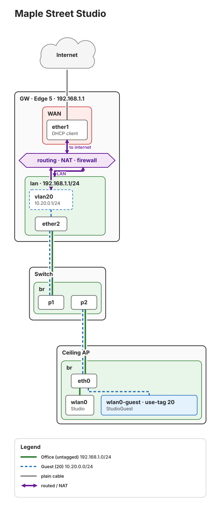

<h1>
  <picture>
    <source media="(prefers-color-scheme: dark)" srcset="assets/wordmark-dark.svg">
    
  </picture>
</h1>

netink draws network diagrams from a short text file: you describe the
routers, switches, access points, cables and VLANs, and it lays them out and
writes an SVG. It works out which VLANs each cable carries and draws them as
coloured lanes, so the picture stays right when the network changes.

<p align="center">
  
</p>

That picture comes from this file, [`examples/quickstart/network.net`](examples/quickstart/network.net):

```net file=studio.net
title "Maple Street Studio"
vlan office untagged color green subnet 192.168.1.0/24
vlan guest 20 color blue subnet 10.20.0.0/24
cloud internet "Internet"
device gw model "Edge 5"
  wan ether1 dhcp nat
  router
  bridge lan address 192.168.1.1/24 lan
    ports ether2
  vlan-iface vlan20 on lan vlan 20 address 10.20.0.1/24 guest
device sw "Switch"
  bridge br
    ports p1, p2
device ap "Ceiling AP"
  bridge br
    ports eth0
    radio wlan0 ssid Studio
    radio wlan0-guest tag 20 ssid StudioGuest
link internet -- gw.ether1
link gw.ether2 -- sw.p1
link sw.p2 -- ap.eth0
```

Nobody wrote down that the cables to the switch and the access point carry
the guest VLAN: netink saw VLAN 20 on the router and on the guest Wi-Fi and
drew the dashed blue lane between them.

## Install

netink is a single executable with no dependencies.

1. Download the file for your system from the
   [latest release](../../releases/latest): `netink-linux-x64`,
   `netink-linux-arm64`, `netink-darwin-arm64` (Apple silicon),
   `netink-darwin-x64` (Intel Mac), `netink-windows-x64.exe` and so on.
   The `-musl` Linux builds are for Alpine and other musl-based systems.
2. Rename it to `netink` and make it executable:

   ```text
   mv netink-linux-x64 netink
   chmod +x netink
   ```

   On Windows, rename it to `netink.exe` instead; no `chmod` is needed.
   On macOS the binaries are not notarized: after a browser download run
   `xattr -d com.apple.quarantine netink` (or download with `curl`).

3. Put it in a directory on your `PATH`, such as `~/.local/bin` or
   `/usr/local/bin`.
4. Optionally, install the manual page `netink.1` from the same release into
   a man directory, for example `~/.local/share/man/man1`, so `man netink`
   works.

To build from source instead, install [mise](https://mise.jdx.dev), then
in a clone of this repository run `mise trust && mise install`, then
`mise exec -- bun install`, then `mise run build`. The executable is written to `dist/netink`.

## Quick start

Create a file, add a few things to it from the command line, and draw it:

```console
$ netink init
$ netink cloud add internet --label Internet
cloud internet "Internet"
$ netink device add gw --model "Edge 5"
device gw model "Edge 5"
$ netink link add internet gw
link internet -- gw
$ netink render -o network.svg
```

`netink init` creates `./network.net`; every other command reads and edits
that file unless you pass `--file`. Each `add` prints the line it wrote. You
can just as well open `network.net` in an editor: it is plain text, and the
commands only save typing.

`netink check` reports mistakes with their line numbers, and
`netink show links` lists every cable with the VLANs it carries.

## A bigger example

[This home network](test/fixtures/home.golden.svg) has a router with a
primary uplink and an LTE backup, a switch, two access points sharing a guest
network, and a handful of clients. Its routers and access points are read from
MikroTik `.rsc` exports rather than written by hand. netink's test suite
renders it on every run and compares the result with that file.

## Documentation

- [The netink language](docs/dsl.md): a worked example, then every statement
  and the rules netink uses to fill in what you leave out.
- [The command line](docs/cli.md): every command and flag, and the JSON
  output for scripts.

`netink help` and `netink <command> --help` print the same in short form.

## Versioning

netink follows [semantic versioning](https://semver.org). While the version
is 0.x, a minor release (0.1 to 0.2) may change the language or the command
line flags; read the [changelog](CHANGELOG.md) before upgrading. A patch
release (0.1.0 to 0.1.1) only fixes bugs.

## License

MIT; see [LICENSE](LICENSE).
